# Xeon Phi Knights Corner "QCL0" engineering sample: firmware and notes

The original firmware dump, tools, and markings from one specific Intel Xeon Phi Knights Corner card, a pre-production **QCL0 engineering sample**. This isn't a Knights Corner explainer. It's the stuff that's specific to this card and hard to find anywhere else: its exact markings, its dumped firmware, and what I found digging into it.

<p align="center">
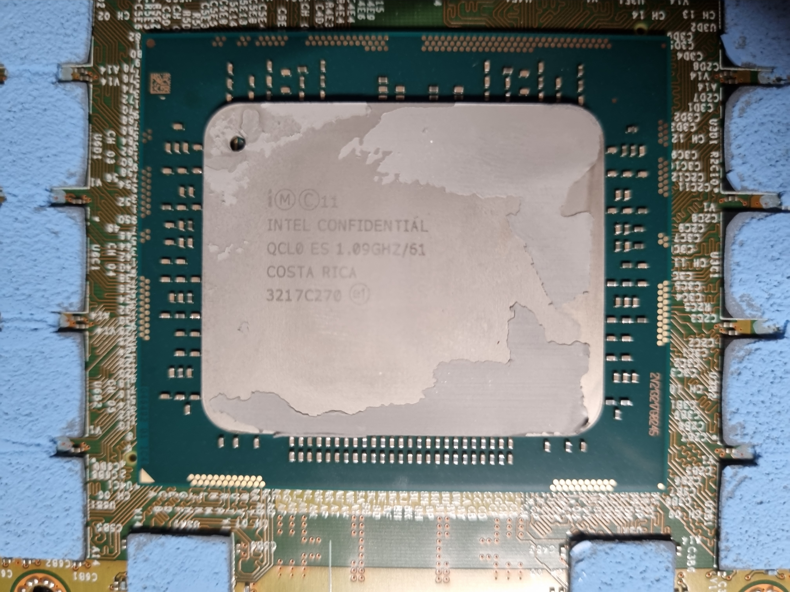</p>
<p align="center"><sub>Heatsink off, and the die up close: <b>INTEL CONFIDENTIAL, QCL0 ES 1.09GHz/61, COSTA RICA</b>.</sub></p>

## What this specific card is

| | |
|---|---|
| Die marking | `INTEL CONFIDENTIAL, QCL0 ES 1.09GHz/61, COSTA RICA` |
| Stepping | **B0** (native class/rev fuse shadow `0x8007d5c74` = `0x0b400010`) |
| PCI ID | `8086:225c` (61-core, 7120-class SKU) |
| Product code / MM | `SPE204PPP` / `922890` |
| Serial / tracking | `ADKC22500083 TA G65757-200` |
| Board marking | `G41903-001 / 00287560101`, dated 2012-03-01 |
| Board label | `G30238-002` |
| PCB fab | AT&S `G61449-002` |
| SMC | **NXP LPC2305** (ARM7) microcontroller, I²C `0x28` |
| GDDR5 | Elpida `W2032BBBG` |
| SPI flash | 2 MB; the dump is [in this repo](#the-firmware-dump) |
| Flyer | Knights Corner Safety Flyer `G56132-001`, marked *engineering use only, not for resale* |

Measured off the SMC at idle: core rail (VCCP) about **0.99 V**, uncore (VDDG) about **1.00 V**, GDDR (VDDQ) about **1.50 V**, hottest die sensor about **53 °C**, package about **26 W**. Like every compute Knights Corner, this die still physically carries Larrabee's texture-sampler / GPU blocks, fused off. Getting them back is the thread that runs through the notes below.

<details>
<summary>Register map and SMC telemetry readout (for the tooling)</summary>

Card-physical register blocks: SBOX `0x8007d0000` (clocks, fuses, APIC, scratch), DBOX `0x8007c0000` (postcode, the I²C/GMBUS master), GBOX0 `0x8007a0000` (memory), TXS0 to TXS7 at `0x800780000` down to `0x800710000` (the fused-off texture samplers, stride `0x10000`). Useful ones: `DCC00` at `0x8007dcc00` (core/ring clock), the per-block gate bitmap `DCC54` to `DCC64`, the graphics PLL `DAB30` at `0x8007dab30`, the fuse shadow `0x8007d5c74`. From the host, SBOX maps into BAR4 at `0x10000`, so any `0x8007dXXXX` register is BAR4 `0x1XXXX`.

SMC read over the I²C master: write `0x282` to `0x8007c5100`, the descriptor to `0x8007c5104`, read `0x8007c510c` after it settles. `0x3c` VCCP, `0x3d` VDDQ, `0x3e` VDDG, `0x40` die temp, `0x41` to `0x48` zone temps, `0x2a` package power.

</details>

## What came with it

It came complete: the original Intel factory box with custom foam, the card in its anti-static bag, the mounting bracket and screws, and the Intel "Knights Corner Safety Flyer" (`G56132-001`). Its third page states plainly it's an *engineering development product, not for resale or lease, engineering use only*. The labels date assembly to 2012-03-01 and packing to 2012-06-28.

<p align="center">
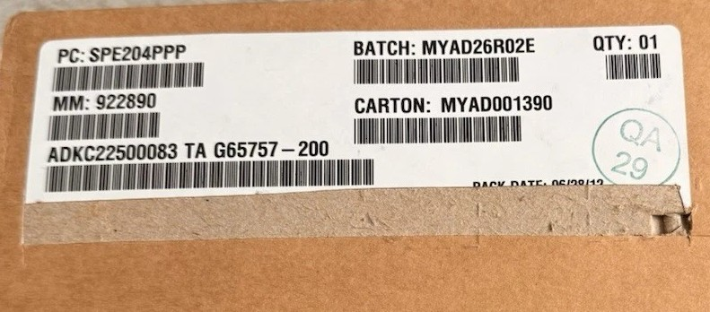
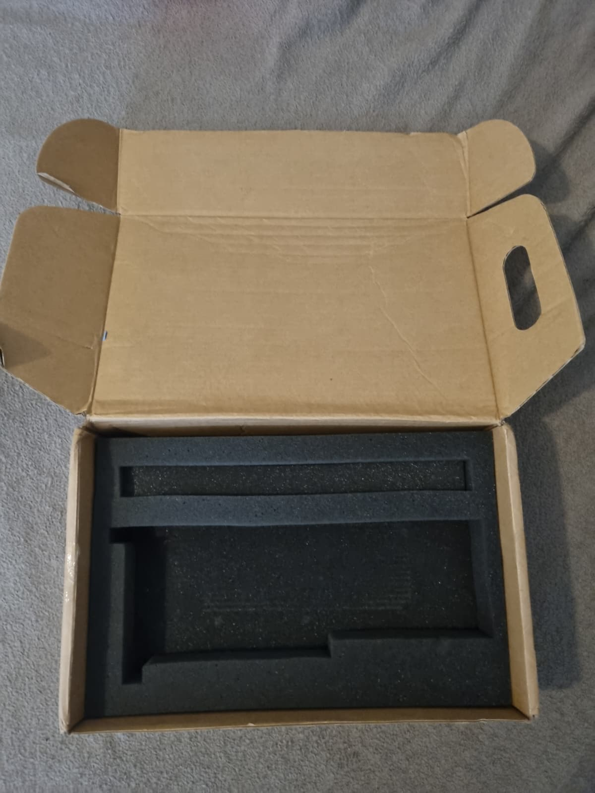
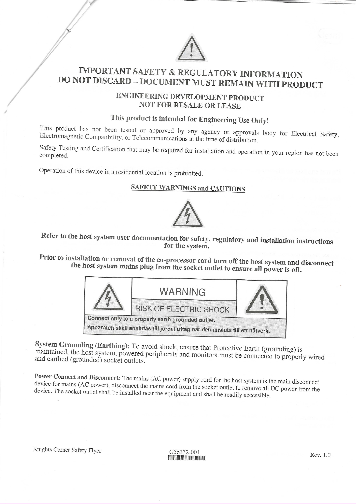
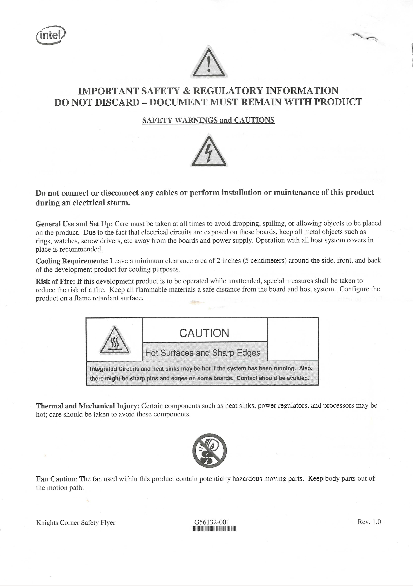
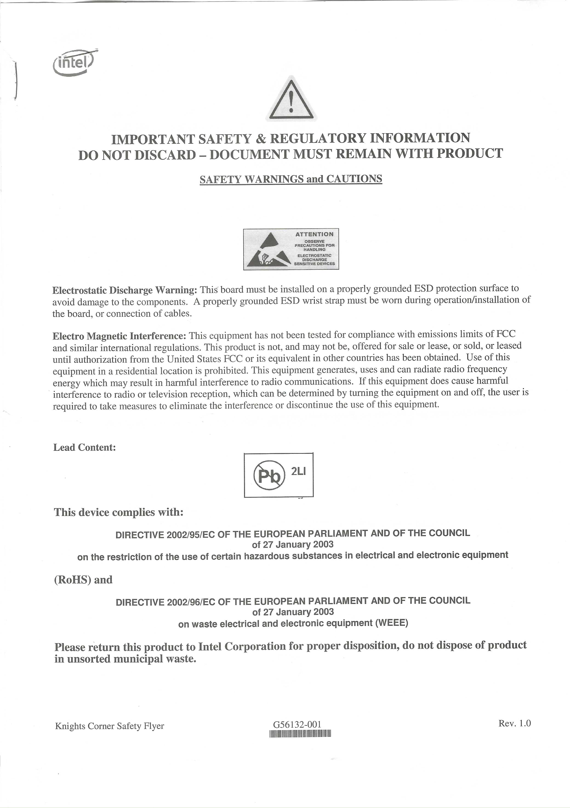
</p>

## The firmware dump

The main reason this repo exists: the card's original firmware, [`firmware/knc-qcl0-es-original-dump.bin`](firmware/knc-qcl0-es-original-dump.bin). It's the complete 2 MB SPI image read off this card (with flashrom) before anything was modified, so it's exactly what it shipped with, serial and all. As far as I can tell it's the first Knights Corner *engineering-sample* firmware made public; the production 7120A image has been dumped before, but not an ES.

```
file     knc-qcl0-es-original-dump.bin
size     2,097,152 bytes (2 MB)
md5      661e0ffd00e4c2e2acc5e32d049a18ac
sha256   8cc7d6a3d6da508d3e8a9c18a4c0ca97db9fd4cafb55e6082646a5b6b3bacfc1
```

**Layout.** The flash maps to the top of the card's address space. The second-stage bootstrap sits at file offset `0x70000` (runs at `0xfffe0000`); a maintenance module is higher up; the board config (GCT), including the serial, is near the end. One thing that matters a lot downstream: the clock and fuse configuration the firmware programs **is not stored in this flash**. It's read live from an on-die strap region at boot, which is why the GPU can't be un-gated by editing this image.

**Is it signature-checked? (open question, help wanted.)** There's a 512-byte high-entropy blob right after the bootstrap header, at `0x70080`, shaped exactly like a signature, and it's present in every image I've dumped, so the bootstrap is almost certainly signed. What I have **not** verified is the root of trust: whether a hash of the signing key is actually burned into an on-die boot ROM (true secure boot) or it's anchored some weaker way. And because this firmware is **field-updatable** (I reflashed it), the verifying key and the signature **have to be carried in the image itself**, so they're in this dump. That makes it analyzable now: the signature is at `0x70080`, the public key is somewhere in here, and whether there's a real on-die anchor is wide open. If firmware-security RE is your thing, this is the interesting part.

**Dump your own / recover.** Read it in software by mapping the 2 MB flash window over PCIe, or pull and rewrite it with an external SPI programmer via the board's flash-isolation strap (also the recovery route if you brick one).

**Copyright.** This is Intel's firmware, published for preservation of long-discontinued hardware. Intel holds the copyright; it is **not** covered by this repo's MIT license, which is only my own tools and notes. It's the untouched dump from my own card, so it contains the board serial in the GCT region; zero those 12 bytes first if you'd rather not publish the serial from your own card.

## Running your own code on the cores

The flashed bootstrap is signed and a modified one wouldn't boot, so editing the firmware is a dead end regardless of how the check is rooted. But that only guards the *flashed* image. The card also accepts code **downloaded from the host over PCIe** during bring-up, and that path isn't signature-checked. So you write a payload into card memory, set the one host-side flag the boot code checks before it jumps, and poke it with an inter-processor interrupt on a spare vector; the parked core redirects into your code and runs it, with full access to the cores, ring and register blocks.

[`fdm.c`](fdm.c) is the tool built on that: a single host C program that injects a small resident monitor and gives you live `peek`, `poke`, `call` and `dump` against any card address, plus `recover` to bus-reset the card when something hangs.

<details>
<summary>The injection sequence</summary>

1. Write the payload to card-physical `0x70000` through BAR0 (the 8 GB aperture).
2. Set the low byte of the host-only "jump to 0x70000" flag at BAR4 `0x14118`. The boot code only reads it; it's there for host download.
3. IPI on vector `0xF2`: apic id to BAR4 `0x1aa0c`, then `0x20f2` to `0x1aa08`. A redirect handler points the parked core's return at `0x70000`.

The monitor talks to the host through a GDDR mailbox at `0x72000`. If a poke hangs the core, `fdm recover` pulses the PCIe bridge secondary-bus-reset and restores config space; the card re-parks in 15 to 30 seconds. Clear the jump flag before the reset. Reads are fault-guarded (a resetting card returns `0xffffffff`).

</details>

## Larrabee still in the firmware

Knights Corner is the second Larrabee chip (Larrabee 2 internally), reworked for compute, and the firmware makes that obvious. It still carries the complete graphics bring-up and runs it at boot. From the dumped image:

* **A graphics-present fuse gates the whole GPU path.** The boot code reads the fuse shadow at `0x8007d5c74` and only takes the graphics route when its high word reads `0x0300`. On this card the native value is `0x0b40`, graphics off. Force it to `0x0300` and the firmware runs the entire Larrabee bring-up (it just can't finish, for the reasons in the next section).
* **A graphics clock init at `0xfffeb470`** programs the graphics PLL at `0x8007dab30` from the on-die strap region, sets up the fabric address windows, and opens the output clock gate.
* **A per-block bring-up loop at `0xfffea98c`** walks the eight texture samplers, `TXS0` at `0x800780000` down to `TXS7` at `0x800710000`, running reset, clock, fabric, enable and ring-base setup on each. Those are Larrabee's fixed-function texture units, still sitting on the 22 nm die.
* That same loop reads a per-block gate bitmap (`DCC54` through `DCC64`) to decide which blocks to skip, which is how the compute SKU keeps them off.

So the firmware is the clearest proof this die is Larrabee underneath: the whole graphics subsystem is described and driven by code that ships on a compute part.

## The fused-off GPU (why it stays dark)

The texture samplers are on this die but their clock domain is dead and I couldn't start it from software. The short of it: the rails are fine (the SMC readout is all nominal), and the firmware already runs a complete GPU bring-up, but replaying it changes nothing, because every gate it would set is already set at boot. The graphics PLL never locks: I can toggle its enable and program dividers, yet the lock bit never comes up. And every access to a texture block hangs the core on the second touch, which is what a clock-crossing FIFO does with nothing clocking the far side; it happens even on the block's config registers, so it's gated at the power/clock-island level. The one promising lever was a set of per-block gate bits the boot loop reads to decide which blocks to skip, but those turned out to be read-only hardware status: writes are ignored, the bits read straight back. So the disable is a hardware strap sitting **below** the registers and below the writable fuse shadow. Nothing the firmware or registers can reach moves it.

That the board is layout-identical to the graphics-enabled debug boards (same routing, same power, they only *added* connectors) is what tells me the gate is on the die, not the board.

## Gallery

Click any shot for the full-resolution image.

<p align="center">
<a href="images/card-in-server.jpg">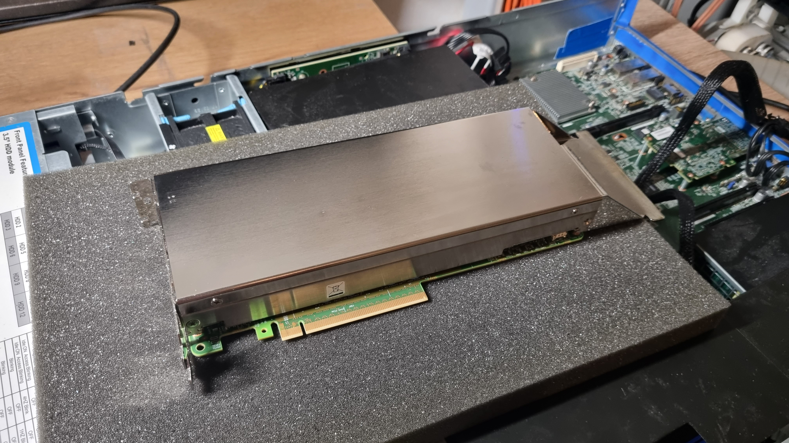</a>
<a href="images/card-back.jpg">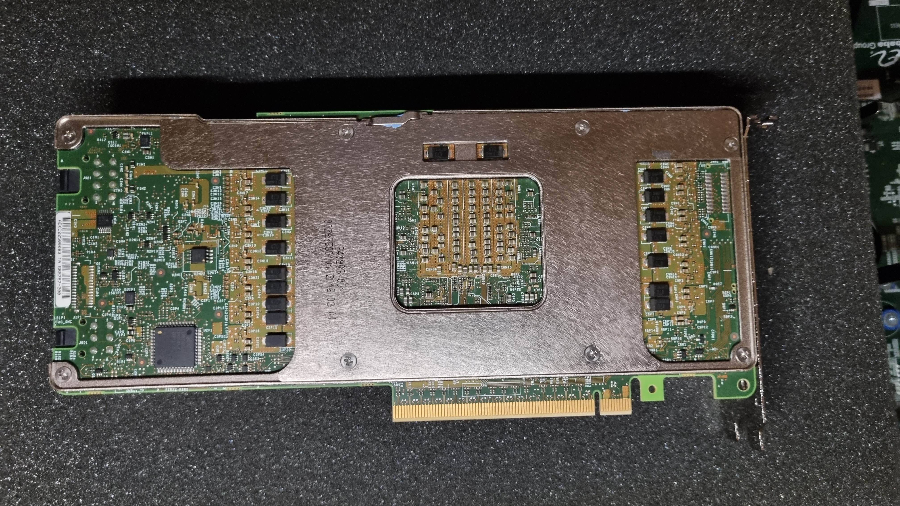</a>
<a href="images/card-side.jpg">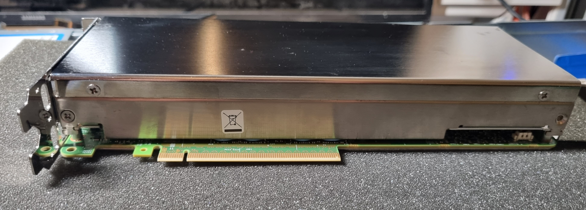</a>
<a href="images/bracket-end.jpg">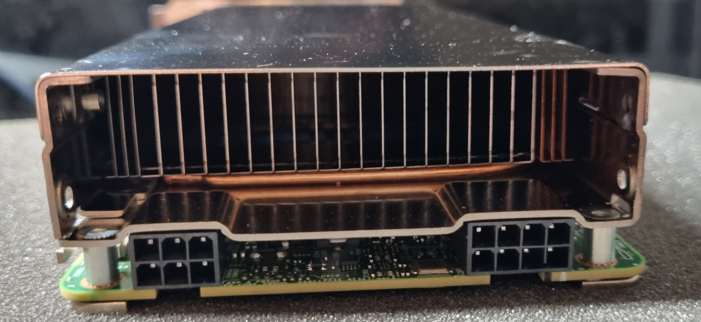</a>
<a href="images/pcb-corner.jpg">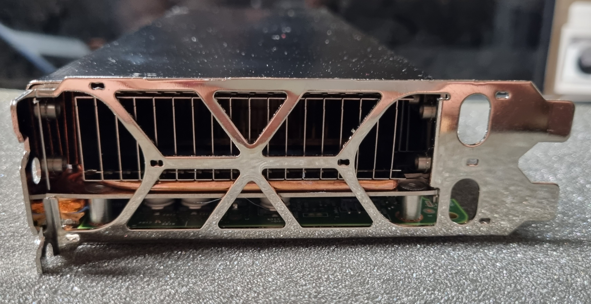</a>
<a href="images/pcb-corner-2.jpg">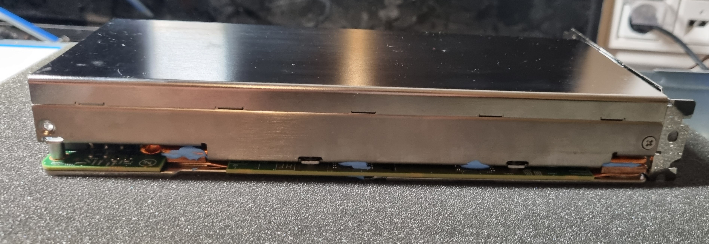</a>
</p>

<p align="center">
<a href="images/board-back-smc.jpg"></a>
<a href="images/board-back.jpg">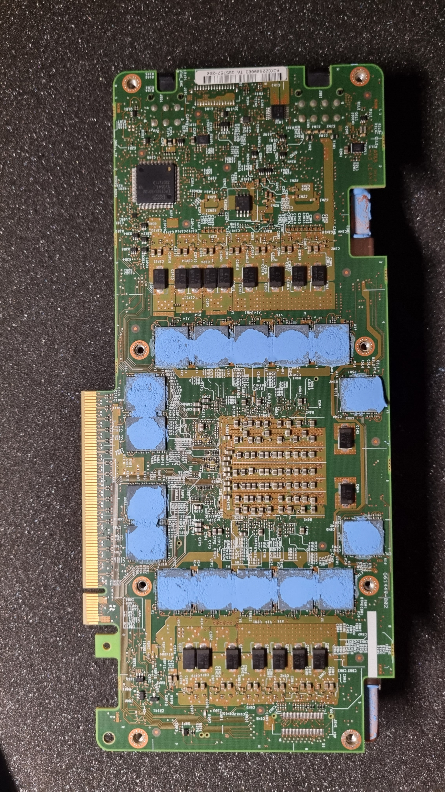</a>
<a href="images/heatsink-copper.jpg">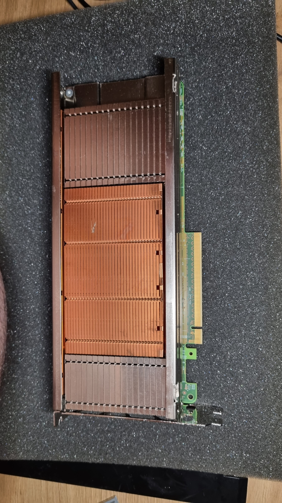</a>
<a href="images/gddr5-closeup.jpg">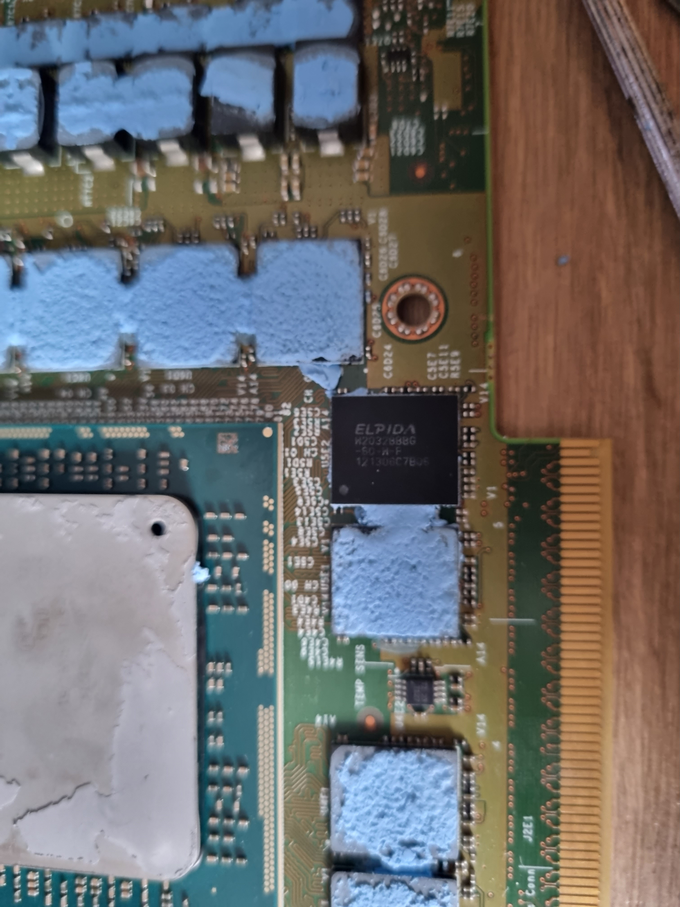</a>
<a href="images/board-corner-detail.jpg">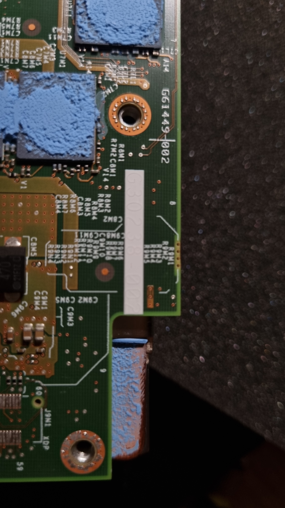</a>
</p>

## Safety and license

These cards are irreplaceable and easy to kill: voltage work, fine-pitch soldering, and a signed boot that bricks on a bad flash. No warranty; break it and that's on you.

Tools and notes are mine under [MIT](LICENSE). Register names and offsets are from my own reverse engineering, for interoperability and preservation. The firmware is Intel's, included for preservation as noted above. Contributions and discussion welcome: other dumps, an A-step or Knights Ferry readout, or someone who cracks that `0x70080` signature. Questions and findings are good in the repo's Discussions tab.
